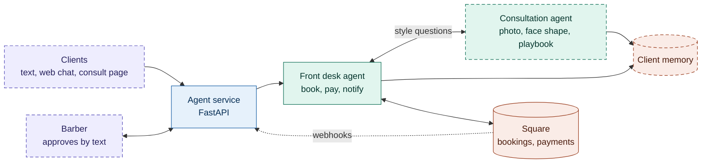

# agentic-barbershop

An AI front desk and style consultant for an independent barbershop.

Clients text a number (or use the site) to book, reschedule, pay and get a haircut
consultation. The agents talk like a person, loop the barber in when something is
unusual, and keep Square as the single source of truth for bookings and payments.

## Architecture



Purple: people. Blue: our service. Green: agents. Orange: data and Square.
Dashed borders are planned; solid are built. As pieces ship, remove them from the
`class ... planned` line.

How a text flows: Twilio calls the webhook, the service acknowledges right away and
queues the message, the front desk agent works it (calling the consultation agent or
Square as needed), then replies through the Twilio API. Twilio gives a webhook only
15 seconds, so replies are never sent inline.

## Repo layout

| Path | What | Status |
|---|---|---|
| `services/agent/` | Python service: FastAPI app, Strands agents, Square/Twilio integrations | skeleton |
| `apps/web/` | Next.js site, consult page, compliance pages | planned |
| `infra/` | AWS CDK (TypeScript) | planned |

## Stack

- **Python 3.13** for the agent service: agents ([Strands](https://strandsagents.com)), Square SDK, MediaPipe.
- **TypeScript** for the web app (Next.js), in-browser MediaPipe and AWS CDK.
- **FastAPI** in front of the agents: async (agents mostly wait on Bedrock and Square), Pydantic models, streaming responses for web chat.
- **uv** for Python packaging, **ruff** for lint/format, **pytest** for tests.

## Roadmap

Each line is roughly one small PR.

**Phase 0: foundations**
- [x] Repo skeleton, CI, health endpoint
- [x] Square client: services, availability, booking (timezone-correct), customers by phone
- [x] Front desk agent v0 with Square tools, local chat CLI
- [x] `/chat` endpoint with per-conversation memory (in process for now)
- [x] Scenario tests: scripted conversations against a real model
- [x] AWS profile support for local Bedrock calls, run-locally guide
- [ ] Infra: Lambda + API Gateway + DynamoDB + Secrets Manager (CDK)
- [ ] Square webhook endpoint with signature verification

**Phase 0.5: compliance**
- [ ] Web app skeleton with privacy policy, terms and SMS opt-in pages; submit Twilio A2P registration

**Phase 1: agents**
- [ ] Conversation persistence (Strands session manager)
- [ ] Client profile memory
- [ ] Consultation agent v2 (Claude vision + measurements + barber playbook)
- [ ] Front desk calls consultation agent; recommendation into booking

**Phase 2: SMS**
- [ ] Twilio inbound webhook, queue, outbound replies, message batching
- [ ] Barber approval and takeover
- [ ] Notifications from Square webhooks, rebooking nudges, waitlist

**Phase 3: consult page** live MediaPipe overlay, snapshot to agent, book from result

**Later:** payments ledger and reminders, dashboard, try-on images, full site and portfolio

## Run it locally

Talk to the front desk with Claude on Bedrock and a fake shop (no Square account needed).

1. **Install** [uv](https://docs.astral.sh/uv/) and the [AWS CLI](https://docs.aws.amazon.com/cli/latest/userguide/getting-started-install.html), then `uv sync --all-packages`.
2. **AWS access** (one time):
   - An AWS account with a payment method on file.
   - A user with the `AmazonBedrockFullAccess` policy, signed in on your machine with
     `aws configure sso` (gives you a named profile).
   - In the Bedrock console, open **Model catalog**, pick an Anthropic Claude model and submit
     the one-time use-case form if it asks. Claude is enabled on the first call; that can
     take up to 15 minutes, during which calls may return `AccessDeniedException`.
3. **Configure:** `cp .env.example .env`, keep `SQUARE_MODE=fake`, set `AWS_PROFILE` to your
   profile name (and `AWS_REGION` if not `us-west-2`).
4. **Chat:** `uv run --package agent-service python -m agent_service.chat --phone 4085550123`
   (terminal), or start the API with
   `uv run --package agent-service uvicorn agent_service.app:app --reload` and POST to `/chat`.
5. **Check it:** `uv run pytest -m scenario -v` runs 10 scripted conversations against Claude.

No AWS yet? Set `MODEL_PROVIDER=anthropic` and `ANTHROPIC_API_KEY` instead.

## Development

```bash
uv sync                      # install workspace + dev tools
uv run ruff check .          # lint
uv run ruff format .         # format
uv run pytest                # tests (no model calls)
uv run pytest -m scenario -v # conversations with a real model (needs model access)
uv run --package agent-service uvicorn agent_service.app:app --reload   # run the service
```

Copy `.env.example` to `.env` for local secrets. Never commit `.env`.

Chat with the front desk agent in your terminal. `SQUARE_MODE=fake` uses an in-memory
shop (sample services, Thursday and Saturday hours), so it only needs model access:

```bash
uv run --package agent-service python -m agent_service.chat --phone 4085550123
```

Or over HTTP, the way texting and the website will use it. Start the service, then send
messages; reuse the returned `conversation_id` to continue a conversation:

```bash
uv run --package agent-service uvicorn agent_service.app:app --reload
curl -s localhost:8000/chat -H 'content-type: application/json' \
  -d '{"message": "any openings saturday?", "phone": "4085550123"}'
```

Read-only check against your Square account (lists services and the next open slots):

```bash
uv run --package agent-service python -m agent_service.square.smoke
```
