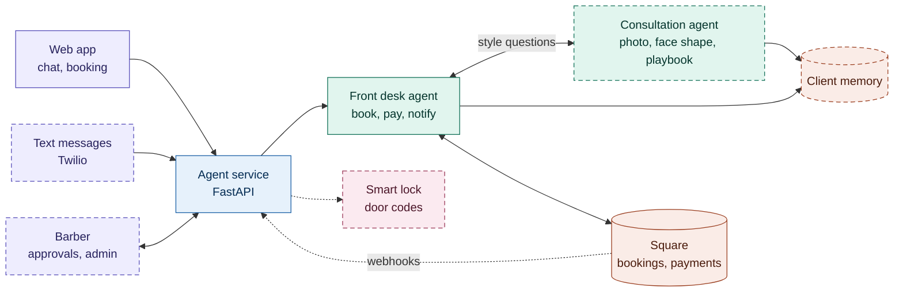

# agentic-barbershop

An AI front desk and style consultant for an independent barbershop.

Clients text a number (or use the site) to book, reschedule, pay and get a haircut
consultation. The agents talk like a person, loop the barber in when something is
unusual, and keep Square as the single source of truth for bookings and payments.

## Architecture



Purple: people and how they reach us. Blue: our service. Green: agents. Orange: data and Square.
Pink: devices. Dashed borders are planned; solid are built. As pieces ship, remove them from the
`class ... planned` line.

How a text flows: Twilio calls the webhook, the service acknowledges right away and
queues the message, the front desk agent works it (calling the consultation agent or
Square as needed), then replies through the Twilio API. Twilio gives a webhook only
15 seconds, so replies are never sent inline.

## Repo layout

| Path | What | Status |
|---|---|---|
| `services/agent/` | Python service: FastAPI app, Strands agents, Square/Twilio integrations | skeleton |
| `apps/web/` | React web app (Vite + TypeScript + Tailwind + shadcn/ui): chat now; consult page and site later | chat |
| `infra/` | AWS CDK (TypeScript) | planned |

## Stack

- **Python 3.13** for the agent service: agents ([Strands](https://strandsagents.com)), Square SDK, MediaPipe.
- **TypeScript** for the web app (React + Vite + Tailwind), in-browser MediaPipe and AWS CDK.
- **FastAPI** in front of the agents: async (agents mostly wait on Bedrock and Square), Pydantic models, streaming responses for web chat.
- **uv** for Python packaging, **ruff** for lint/format, **pytest** for tests.

## Roadmap

Each line is roughly one small PR.

**Built**
- [x] Repo skeleton, CI, health endpoint
- [x] Square client: services, availability, booking (timezone-correct), customers by phone
- [x] Front desk agent v0 with Square tools, local chat CLI
- [x] `/chat` endpoint with per-conversation memory (in process for now)
- [x] Scenario tests: scripted conversations against a real model
- [x] AWS profile support for local Bedrock calls, run-locally guide
- [x] Web app (React): chat with the front desk, runs locally and builds for production
- [x] Codespaces dev environment and one-command local start
- [x] Booking calendar: pick a service, day and time without chatting

**Deploy**
- [ ] Infra: Lambda + API Gateway + DynamoDB + Secrets Manager + S3/CloudFront (CDK)
- [ ] Conversations kept across restarts (DynamoDB)
- [ ] Square webhook endpoint with signature verification

**Texting**
- [ ] Privacy policy, terms and SMS opt-in pages; submit Twilio A2P registration
- [ ] Twilio inbound webhook, queue, outbound replies, message batching
- [ ] Barber approval and takeover by text
- [ ] Notifications from Square webhooks, rebooking nudges, waitlist
- [ ] Running-late check-ins: confirm timing with the barber mid-cut, warn the next client

**Admin and door access**
- [ ] Admin area: sign-in, approvals, today's schedule
- [ ] Smart lock: a door code per booking sent by text, unlock from the admin area

**Consultation**
- [ ] Client profile memory
- [ ] Consultation agent v2 (Claude vision + measurements + barber playbook)
- [ ] Consult page: live face overlay, recommendation straight into booking

**Later:** payments ledger and reminders, dashboard, try-on images, full site and portfolio

## Develop in Codespaces

No local setup: everything runs in a cloud Linux machine and opens in your browser.

Full step-by-step, what's testable at each stage and where keys go: [docs/DEVELOPING.md](docs/DEVELOPING.md).

1. On GitHub: **Code → Codespaces → Create codespace on main**. The first start installs
   everything (a few minutes).
2. In the terminal: `scripts/dev.sh`. It starts the API and the web app; the web app opens in
   a new tab (or use the **Ports** tab, "Web app").
3. It uses the practice shop (`SQUARE_MODE=fake`), so no Square account is needed. Chat replies
   need model access: run `aws configure sso` and set `AWS_PROFILE` in `.env`, or set
   `MODEL_PROVIDER=anthropic` and `ANTHROPIC_API_KEY`.

Codespaces stop after 30 idle minutes. The free plan covers about 60 hours a month on the
default 2-core machine.

## Run it locally

Talk to the front desk with Claude on Bedrock and a fake shop (no Square account needed).

1. **Install** [uv](https://docs.astral.sh/uv/), Node 22 and the [AWS CLI](https://docs.aws.amazon.com/cli/latest/userguide/getting-started-install.html), then `uv sync --all-packages` and `npm ci` in `apps/web`.
2. **AWS access** (one time):
   - An AWS account with a payment method on file.
   - A user with the `AmazonBedrockFullAccess` policy, signed in on your machine with
     `aws configure sso` (gives you a named profile).
   - In the Bedrock console, open **Model catalog**, pick an Anthropic Claude model and submit
     the one-time use-case form if it asks. Claude is enabled on the first call; that can
     take up to 15 minutes, during which calls may return `AccessDeniedException`.
3. **Configure:** `cp .env.example .env`, keep `SQUARE_MODE=fake`, set `AWS_PROFILE` to your
   profile name (and `AWS_REGION` if not `us-west-2`).
4. **Run** `scripts/dev.sh` and open <http://localhost:5173> (web app). Or chat in the
   terminal: `uv run --package agent-service python -m agent_service.chat --phone 4085550123`.
5. **Check it:** `uv run pytest -m scenario -v` runs 10 scripted conversations against Claude.

No AWS yet? Set `MODEL_PROVIDER=anthropic` and `ANTHROPIC_API_KEY` instead.

## Development

```bash
uv sync                      # install workspace + dev tools
uv run ruff check .          # lint
uv run ruff format .         # format
uv run pytest                # tests (no model calls)
uv run pytest -m scenario -v # conversations with a real model (needs model access)
uv run --package agent-service uvicorn agent_service.app:app --reload   # run the service
```

Copy `.env.example` to `.env` for local secrets. Never commit `.env`.

Chat with the front desk agent in your terminal. `SQUARE_MODE=fake` uses an in-memory
shop (sample services, Thursday and Saturday hours), so it only needs model access:

```bash
uv run --package agent-service python -m agent_service.chat --phone 4085550123
```

Or over HTTP, the way texting and the website will use it. Start the service, then send
messages; reuse the returned `conversation_id` to continue a conversation:

```bash
uv run --package agent-service uvicorn agent_service.app:app --reload
curl -s localhost:8000/chat -H 'content-type: application/json' \
  -d '{"message": "any openings saturday?", "phone": "4085550123"}'
```

Read-only check against your Square account (lists services and the next open slots):

```bash
uv run --package agent-service python -m agent_service.square.smoke
```

### Web app

The client-facing app in `apps/web/` (React, Vite, TypeScript, Tailwind, shadcn/ui components in `src/components/ui`). It has two tabs: **Book** (service, day, time, details) and **Chat** (the front desk agent). Booking works without model access. It talks to the
agent service through `/api`, which the dev server forwards to `localhost:8000`.

```bash
scripts/dev.sh      # API + web app together; open localhost:5173
cd apps/web
npm test            # UI tests
npm run build       # production build in apps/web/dist (static files)
```

In production the built files are served as a static site, with `/api` routed to the agent
service (set up with the AWS infrastructure). Settings live in `apps/web/.env.example`.
